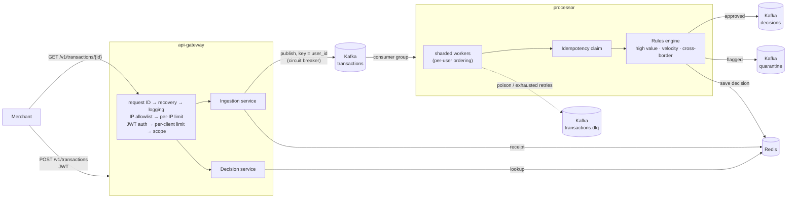

# Fraud Detection Platform

[](https://github.com/umangutkarsh/fraud-detection-platform/actions/workflows/ci.yml)

An event-driven transaction ingestion and fraud-detection platform written in Go.
Merchants submit payments to an authenticated REST gateway; each payment is
published to Kafka, scored by a rules engine in a separate processor service,
and the decision becomes readable through the same API.

It is built around the problems that matter in payments: **never lose a
transaction, never process one twice, keep one merchant's data away from
another, and degrade predictably under load.**

## Architecture



1. The gateway authenticates the merchant, validates the payload, stamps the
   **authenticated** merchant ID on it (never one supplied by the client), and
   publishes it to Kafka. It answers `202 Accepted` only after Kafka has
   acknowledged the write.
2. The processor consumes from Kafka, scores the transaction, publishes the
   decision to the `decisions` or `quarantine` topic, and stores it in Redis.
3. The merchant polls `GET /v1/transactions/{id}` and sees `pending`,
   `approved` or `under_review`.

## Quick start

Requires Docker, Go (version in `go.mod`) and `openssl`.

```bash
export JWT_SECRET=$(openssl rand -hex 32)   # >= 32 bytes, shared by gateway and token minting
docker compose up -d --build                # Kafka, Redis, processor, gateway, Prometheus
```

Mint a token and try it (HS256, signed with the same secret):

```bash
b64() { openssl base64 -A | tr '+/' '-_' | tr -d '='; }
mint() {  # mint <merchant-id> "<scopes>"
  local h p s
  h=$(printf '{"alg":"HS256","typ":"JWT"}' | b64)
  p=$(printf '{"sub":"%s","iss":"api-gateway","exp":%d,"scope":"%s"}' "$1" $(( $(date +%s) + 3600 )) "$2" | b64)
  s=$(printf '%s.%s' "$h" "$p" | openssl dgst -sha256 -hmac "$JWT_SECRET" -binary | b64)
  printf '%s.%s.%s' "$h" "$p" "$s"
}
TOKEN=$(mint merchant-1 "transactions:write transactions:read")

curl -si localhost:8080/v1/transactions -H "Authorization: Bearer $TOKEN" \
  -d '{"id":"t1","user_id":"u1","amount_minor":2500,"currency":"GBP","country":"GB"}'
# HTTP/1.1 202 Accepted

curl -s localhost:8080/v1/transactions/t1 -H "Authorization: Bearer $TOKEN"
# {"id":"t1","status":"approved","evaluated_at":"...","request_id":"..."}
```

Send two payments from one user within half a second and the second comes back
`under_review` (velocity rule).

| Endpoint | Port |
|---|---|
| Gateway API | `localhost:8080` |
| Gateway metrics / health | `localhost:9100` (`/metrics`, `/healthz`, `/readyz`) |
| Processor metrics / health | `localhost:2112` |
| Prometheus | `localhost:9090` |

Useful commands: `make check` (build, vet, race tests), `make up`, `make down`,
`make logs`.

## API

| Method and path | Scope | Result |
|---|---|---|
| `POST /v1/transactions` | `transactions:write` | `202` accepted, `400` malformed, `422` invalid, `503` ingestion unavailable (retry with the **same id**) |
| `GET /v1/transactions/{id}` | `transactions:read` | `200` decided, `202` still `pending`, `404` unknown (or another merchant's) |

Body: `id`, `user_id`, `amount_minor` (integer pence), `currency`, `country`.
An `Idempotency-Key` header is accepted as an alias for `id`. Errors never
include internals; every response carries an `X-Request-Id` to quote to support.

## Design decisions

**Kafka between the gateway and the processor.** Accepting a payment and
scoring it are decoupled, so a slow or restarting processor never makes the
front door slow, and bursts are absorbed by the log. The cost is that decisions
are asynchronous, so the API is poll-based (`pending` → decided).

**Per-user ordering.** The Kafka key is `user_id`, so one user's events land on
one partition, and inside the processor they are sharded by the same key onto
one worker. Rules that depend on history (velocity, cross-border) therefore see
a user's payments in order.

**At-least-once delivery, made effectively-once by idempotency.** Offsets are
committed only after a message is fully handled, using a contiguous-offset
tracker so a slow message can never let a later one's commit skip over it. A
redelivered message is recognised by a two-phase Redis claim (`processing` for
30 s, then `done` for 24 h) and skipped. If publishing or saving fails, the
claim is released so a retry can succeed. The earlier design this replaced set
the key *before* publishing, which could lose a transaction permanently.

**Failures are classified, not swallowed.** Invalid JSON, failed validation, a
panic, or exhausted retries go to a dead-letter topic with the reason, and the
offset moves on. Transient failures are retried with jittered exponential
backoff. A failed dead-letter write is retried indefinitely rather than
dropping the message, and a shutdown mid-retry leaves the offset uncommitted
so nothing is lost.

**Tenant isolation by construction.** Merchant ID comes only from the verified
JWT subject. Every Redis key is scoped by merchant with length-prefixed
segments (so `a:b` + `c` can never collide with `a` + `b:c`), which means the
same transaction ID from two merchants is two different transactions, and
another merchant's ID is indistinguishable from a missing one (`404`).

**Merchants never see why.** Public statuses are only `pending`, `approved` and
`under_review`. Scores and rule names are never exposed, since telling a
fraudster which rule fired lets them tune around it.

**Gateway hardening.** Middleware runs cheapest-first: request ID, panic
recovery, logging and metrics, IP allowlist, per-IP rate limit, then JWT
verification, per-client rate limit and a per-route scope check. Floods are
shed before any cryptography runs. Tokens must be HS256 and carry `exp`,
`sub` and the expected issuer (`alg: none`, other algorithms and tokens without
expiry are rejected); the response is always a generic 401 while the reason is
logged. `X-Forwarded-For` is trusted only from configured proxies, so a client
cannot spoof an allowed address. Request bodies are capped at 64 KB and unknown
JSON fields are rejected.

**Resilience.** Publishing to Kafka goes through a circuit breaker and answers
`503` with `Retry-After` when open. Rate limiting uses a Redis token bucket
(Lua) with an in-process fallback, and fails open, loudly, if both fail.
Both services shut down gracefully on `SIGTERM`: stop accepting, drain
in-flight work, then close connections.

**Observability.** Structured JSON logs with request IDs; Prometheus metrics
with bounded label cardinality (routes use the template, not the raw URL);
separate admin ports for `/metrics`, `/healthz` and `/readyz`, so probes never
share a listener with customer traffic.

### Fraud rules

| Rule | Trigger | Score |
|---|---|---|
| High value | over £10,000 | 40 |
| Velocity | repeat payment by the same user in quick succession (Lua, uses the transaction timestamp); doubles under 500 ms | 30 base |
| Cross-border | foreign-country payments within a sliding window (sorted set) | 60 |

A transaction scoring 50 or more is quarantined (`under_review`); otherwise it
is approved. Thresholds are configuration, not code.

## Testing

```bash
make check     # go build, go vet, go test -race
```

- Unit tests per package, using in-memory Redis (miniredis) and fakes behind
  interfaces, run with the race detector.
- Middleware tests cover expired, unsigned, wrong-algorithm and wrong-issuer
  tokens, `X-Forwarded-For` spoofing, scope enforcement and rate limiting.
- Route tests drive the full middleware chain over HTTP: auth, tenant
  isolation, validation, a Kafka outage returning `503`, and per-client limits.
- An end-to-end test wires the **real gateway router to the real processor**
  over a shared Redis, with Kafka replaced by an in-process hand-off. It fails
  if the two services ever disagree on the stored decision format.
- CI (GitHub Actions) runs gofmt, build, vet, race tests, golangci-lint,
  govulncheck, and builds both Docker images.

## Load test

`cmd/loadgen` drives the stack through its real front door at a fixed rate and
reports two numbers: **submit latency** (how long the gateway takes to accept)
and **decision latency** (until the processor's decision is readable, sampled).
Latency is measured from each request's *scheduled* start, so overload shows up
in the figures instead of quietly lowering the offered rate.

Single Kafka broker, Redis, processor (8 workers, the default) and gateway in
Docker Desktop (11 CPUs, 8 GB) with the load generator on the same laptop.
Gateway rate limits lifted for the test (`docker-compose.loadtest.yml`).
Figures show the shape of the system, not production capacity.

| Offered (req/s) | Achieved | Submit p99 | Decision p50 | Decision p99 |
|---|---|---|---|---|
| 200 | 210 | 22 ms | 30 ms | 54 ms |
| 500 | 525 | 38 ms | 30 ms | 106 ms |
| 1,000 | 1,050 | 23 ms | 45 ms | 179 ms |
| 2,000 | 2,101 | 30 ms | 1,467 ms | 9,870 ms |

What this shows:

- Up to about 1,000 req/s the whole path stays well under 250 ms at p99 with no
  errors. Repeating the 1,000 req/s run gave decision p99 anywhere from 246 ms
  to about 5 s, so that rate is right at the edge on this machine.
- Beyond that the **processor** is the bottleneck, not the gateway. Submit p99
  stays low (30 ms at 2,000 req/s) because Kafka absorbs the burst, while
  decisions back up and some exceed the generator's 10 s patience.
- **No message was lost.** After the 2,000 req/s run, consumer lag was `0` on
  all six partitions and the offsets matched the number of messages sent: the
  backlog was fully drained.

Reproduce:

```bash
export JWT_SECRET=$(printf 'k%.0s' {1..40})
docker compose up -d --build
make loadtest-up
ulimit -n 10240
scripts/ladder.sh 500 1000 1500 2000
```

Likely next step: the processor runs 8 workers by default, each handling one
message at a time through several Redis calls and a Kafka publish. Raising
`WORKERS` is the first thing to try and measure.

## Configuration

Everything is environment variables; secrets have no defaults.

| Service | Variable | Purpose |
|---|---|---|
| gateway | `JWT_SECRET` | **Required**, at least 32 bytes |
| gateway | `HTTP_ADDR`, `ADMIN_ADDR` | Listen addresses (compose uses `:8080`, `:9100`) |
| gateway | `JWT_ISSUER`, `JWT_AUDIENCE` | Expected token issuer and optional audience |
| gateway | `ALLOWED_CIDRS` | Allowed caller IPs/ranges; empty allows all (warned at startup) |
| gateway | `TRUSTED_PROXIES` | Load balancers whose `X-Forwarded-For` is trusted; empty trusts nobody |
| gateway | `RATE_LIMIT_IP_RPS/BURST`, `RATE_LIMIT_CLIENT_RPS/BURST` | Rate limits |
| both | `KAFKA_BROKERS`, `REDIS_ADDR` | Backing services |
| both | `KAFKA_TLS`, `KAFKA_SASL_*`, `REDIS_PASSWORD`, `REDIS_TLS` | Secure connections |
| processor | `WORKERS`, `BUFFER_SIZE`, `MAX_ATTEMPTS`, `DECISION_TTL` | Concurrency, buffering, retries, decision retention |
| processor | `KAFKA_TOPIC_*`, `KAFKA_GROUP_ID`, `HOME_COUNTRY`, `METRICS_ADDR` | Topics, group, domestic country |

## Repository layout

```
cmd/gateway, cmd/processor, cmd/loadgen   entry points
internal/contract                         shared Transaction / FraudResult and key formats
internal/gateway
  domain/{models,port,service}            business logic and interfaces (no frameworks)
  adapter/application/rest                middleware, handlers, routes (gin)
  adapter/infrastructure                  Kafka, Redis, rate limiting, breaker, metrics
  bootstrap                               composition root: builds everything from config
internal/processor
  pipeline                                consumer, sharded workers, offsets, idempotency, publisher
  rules                                   fraud rules and engine
  config, metrics
scripts/ladder.sh                         repeatable load-test ladder
```

## Known limitations

- Single Kafka broker and single Redis for local use; production would need
  replication, TLS everywhere and managed credentials.
- Tokens are HS256 with a shared secret. At scale, asymmetric keys and a JWKS
  endpoint would let the gateway verify without holding a signing secret.
- Rules are deliberately simple and threshold-based; there is no model scoring
  or case-management workflow yet.
- Decisions are polled, not pushed; a webhook or event stream back to the
  merchant would remove the polling.
